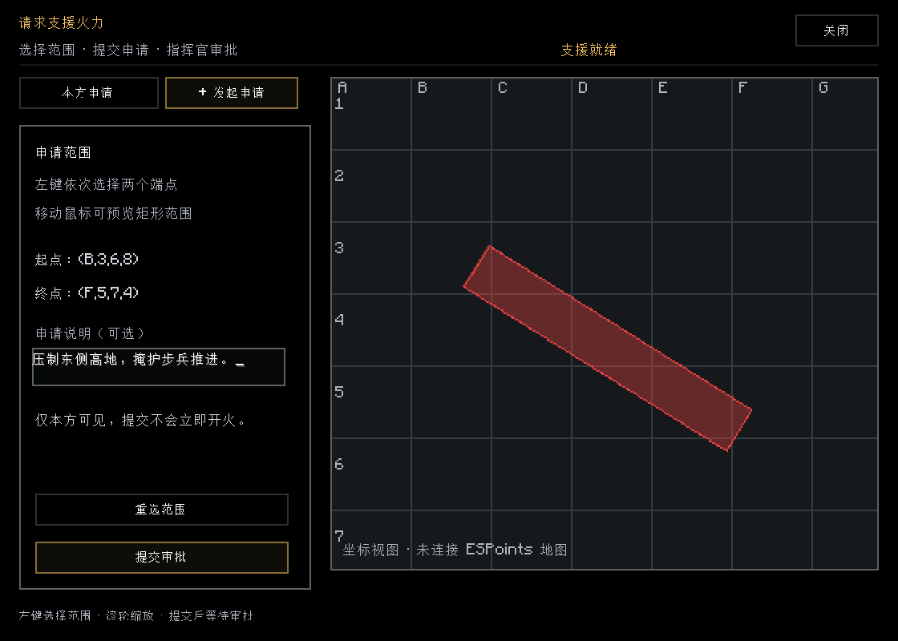
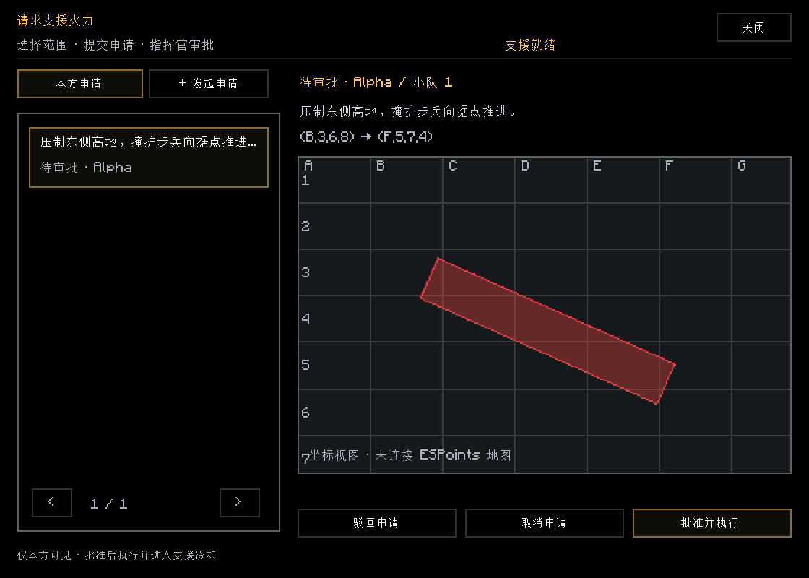

# 请求支援火力

请求支援火力是 **Espetro 本体功能**，不依赖 EsSupport。队长选择支援范围、填写说明，由指挥官复核并批准执行。整个流程只有一种申请，不提供打击方式或指挥官技能分类。

界面直接复用本体部署菜单的 `EspetroMenuScreen` / `EspetroAuiWidgets`：相同的黑色底、细边框、按钮、字体与输入处理。左侧为申请列表或填写区，右侧为地图和审批操作。

截图为实际界面，使用测试样例数据；没有连接活动战局地图时显示坐标视图。

## 使用

- 默认 **U** 打开“请求支援火力”，可在按键设置里改键；也可用 `/esfire`。部署界面右上角有同名入口。
- 战斗阶段，已部署的小队长或指挥官可创建申请。左键依次选择范围的两个端点；选择第一个端点后，移动鼠标预览矩形，第二次点击确认。再次点击或使用“重选范围”可重选，填写申请说明后提交。
- 本方人员能查看申请；敌方不可见。已部署的本方指挥官可“批准并执行”或驳回。申请人、指挥官可取消待审批申请。
- 范围沿用原有地图覆盖区的**红色半透明矩形、细红边**，以两端点连线为轴、两侧各扩展原有覆盖半径（当前各 45 格，宽 90 格）。安装支持该样式的 ESPoints 时直接调用其矩形绘制器；旧版或坐标视图使用相同样式。预览不会提前添加生效覆盖区。
- 审批成功调用本体已有的范围火力执行器，沿用 `artillery_155` 的配置和冷却。界面统一显示支援就绪、支援冷却、申请范围和审批状态；无需再选择技能。原有直接使用火力的入口不受影响，冷却仍然共用。
- 冷却等正常拒绝会保留待审批状态；已经成功下达的申请不能再次执行。底层调用抛异常时停止重复执行，并提示管理员核查。

安装 ESPoints 时使用其嵌入式战术地图和投影；缺少地图集成时退回本局范围的坐标视图。界面显示固定 150 / 50 / (50÷3) 的四级网格坐标，原点为地图左上角。地图鼠标操作只提交申请，不调用 ESPoints 的立即开火入口。

## 服务端规则

`<世界>/serverconfig/espetro-fire-requests-server.toml`：

| 项目 | 默认 | 含义 |
| --- | ---: | --- |
| maximumPerTeam | 48 | 每队保留申请上限，含历史 |
| createIntervalTicks | 200 | 同一玩家两次申请最小间隔 |
| lifetimeTicks | 6000 | 有效期，默认 5 分钟 |
| maximumBarrageLength | 1500 | 支援范围轴线最大长度，方块数 |

服务端复核阶段、部署状态、阵营、指挥官权限、地图边界和战局 session；客户端不能设置审批结果。申请只在本局有效，换战局清空，结束阶段取消未完成申请，服务器重启不恢复。更改配置后重启服务器。

## 验证范围

`FireRequestBoardTest` 覆盖权限、跨阵营隔离、非法坐标与线段、限流、过期、换局、重复/重入审批、冷却重试、异常后的停止重试和固定网格坐标。新增火力源码已编译，并在隔离 Forge 运行环境中验证原有定点与弹幕调用、共享冷却和界面缩放。

当前工作站缺少上游 `VehicleManager` 编译使用的 DragonRise `SupplyStationConfig` / `SupplyStationDataLoader`，因此没有宣称当前 main 整包构建通过。运行验证采用现有本地测试包加本次编译的火力代码与 main 当前技能脚本；验证包不作为完整 main 发布包分发。
